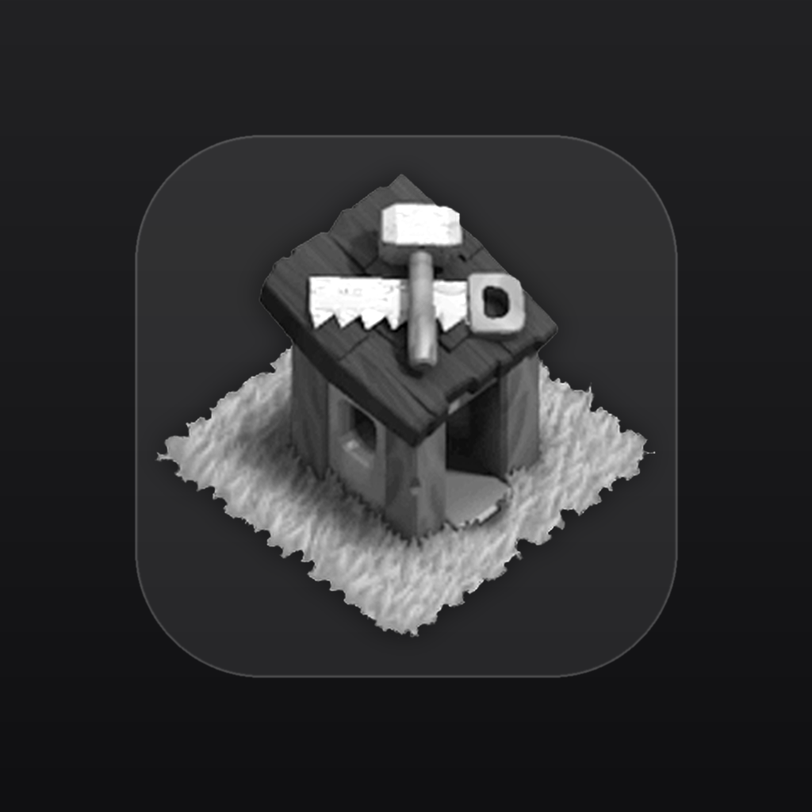

<p align="center">
  
</p>

<h1 align="center">Builder Tracker</h1>

<p align="center">
  <em>Never leave a builder idle again.</em>
</p>

<p align="center">
  
  
  
</p>

---

A Clash of Clans upgrade tracker for **Home Village** and **Builder Base**. Import your data once, get alerts when a builder is about to be free, and check everything from a home-screen widget.

## What it does

- One card per builder: what it's upgrading, time left, progress, or **Free**
- Live countdowns that stay correct while the app is closed
- Alerts 10 minutes before an upgrade finishes, and again when it's done
- Home-screen widget with Home Village / Builder Base tabs

## Download

Grab the latest APK from [Releases](../../releases/latest) and install it on your Android phone. You may need to allow installs from your browser or file manager.

## Use it

The game doesn't expose live builder timers, so the app reads the official Data Export.

1. In Clash of Clans: **Settings → More Settings → Help and Support → Data Export**. Copy the JSON.
2. In the app, tap the import icon, paste, and tap **Import**.
3. Optional: long-press your home screen → **Widgets** → **Builder Tracker**.

After you start or finish upgrades in game, export and import again. The app only knows what was in your last export.

Not tracked: lab research and pets (they don't use builders).

## Develop

```bash
flutter pub get
flutter run
flutter test
```

Android 13+ asks for notification permission. Allow exact alarms for on-time alerts. After changing the widget layout, remove the widget and add it again.

## Fine print

Unofficial. Not affiliated with Supercell. *Clash of Clans* and its artwork, including the Builder's Hut in the icon, belong to Supercell. Replace the icon before publishing publicly. The app only reads the export you paste in and never touches your account.
